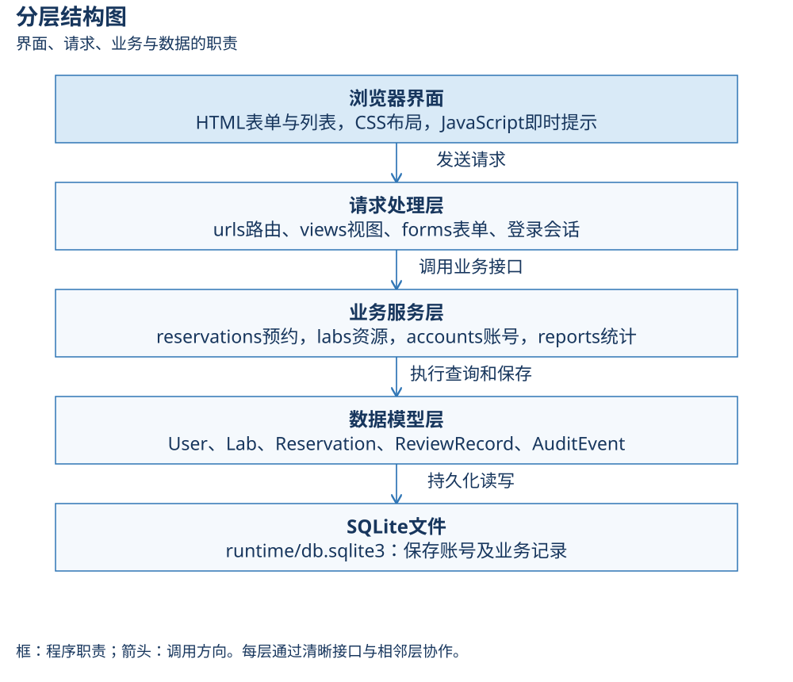
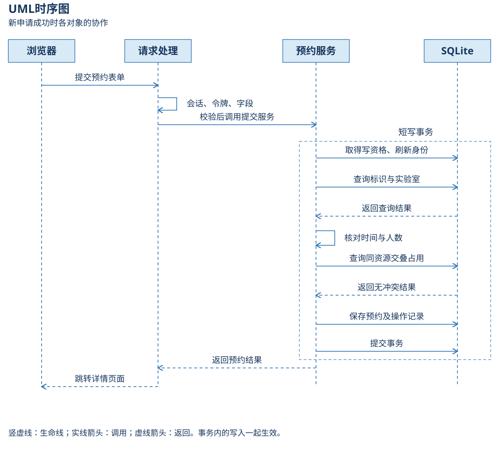

**总体与模块设计——先看分工，再看实现**

**一．用一次预约理解整个系统**

张同学要在明天11:00—12:00使用自动控制实验室，参加6人。页面负责让他选资源、填时间和用途；程序负责检查账号、开放时间、容量和已有占用；数据库负责保存结果；管理员之后批准或拒绝。每部分只承担清楚的责任。

本系统采用浏览器＋本机Python/Django应用＋SQLite文件。浏览器是显示和输入窗口；Django是处理登录、表单和页面的框架；SQLite是把资料存入文件的数据库。没有额外的前端构建或数据库服务器。

**二．课件里的总体设计，在这里做什么**

第7章强调模块化、高内聚、低耦合，第8章强调组成、接口和调用关系。总体设计先决定工作由谁负责，详细设计再决定每项工作如何完成。

高内聚：提交、审核、取消都围绕预约的状态和占用，因此在同一预约服务里处理。低耦合：页面通过明确参数调用服务，不把业务算法复制进HTML；改页面颜色不应改预约规则。信息隐藏：视图调用submit_reservation，不需要知道SQLite如何取得写资格。

这里的“服务”是一组承担业务任务的Python函数，运行在同一个应用中。并不意味着把每个模块部署成一个独立服务器。

**三．层次、模块与实际接口**

| 层或模块 | 通俗职责与例子 | 专业方案与代码位置 | 责任边界 |
|---|---|---|---|
| 展示与输入 | 给同学看列表和申请表 | templates、static中的HTML/CSS/JS | 即时提示不能决定最终授权 |
| 配置与路由 | 收到地址后找到负责的处理入口 | config/settings.py、urls.py；注册应用和环境变量 | 不承载预约冲突算法 |
| 请求处理 | 把“6”转换为整数，解释结果 | views.py、forms.py；解析字段、限制可见对象、产生响应 | 写业务统一调用services |
| 预约服务 | 判断申请、审核、取消能否执行 | services/reservations.py；submit/review/cancel与冲突函数 | 状态规则集中，不能绕过事务 |
| 资源服务 | 管理实验室，并保护已有占用 | services/labs.py；save_lab | 改容量不能破坏有效预约 |
| 账号服务 | 管理角色、启停和密码 | services/accounts.py；save_account | 管理员不能停用或降级本人 |
| 统计服务 | 对预约资料进行只读汇总 | services/reports.py；summarize | 申请人限本人，计划时长不是实际使用率 |
| 公共工具 | 为各服务复用身份检查等能力 | services/common.py；require_user/manager、write_transaction、audit | 写事务只给写业务使用 |
| 数据模型 | 定义一条预约有哪些资料和关联 | models.py、migrations；对象映射、唯一性和基本约束 | 不依赖页面、视图或颜色 |
| 数据存储 | 关闭页面后仍能保存预约 | SQLite，runtime/db.sqlite3 | 属于当前设备数据，不装进Conda环境 |

查看[功能结构图和逐图说明](模型图/模型说明.md)，把“系统能做什么”与“程序由什么组成”区分开。功能模块与代码模块不是一一对应：记录列表在视图中查询，提交、审核、取消集中在预约服务中。

**四．一条请求怎样经过这些层**

1. 浏览器发送资源编号、时段、用途、人数和本次提交标识；身份来自已登录会话。
2. Django根据URL找到视图，通过会话认识当前用户，并验证写请求的CSRF令牌。
3. 表单检查格式，例如人数能否转成整数；视图给服务提供规范参数。
4. 预约服务在短写事务中复查身份、当前资源与同次提交，检查规则和占用。
5. 模型与数据库保存待审核预约和提交操作记录；两项数据一起提交才成功。
6. 服务返回预约对象和是否新建；视图返回跳转地址，浏览器重新读取详情。

“服务端渲染”就是Django把模板与数据组合成HTML，再交给浏览器。模板提供页面骨架，CSS提供排版，JavaScript提供少量即时提示。本系统没有单页应用或浏览器直接连接数据库的方案。

**五．权限：认识身份和允许操作是两件事**

认证回答“你是谁”，授权回答“你可以做什么”。登录成功不表示能访问所有预约。申请人查询先限定本人，再筛选；猜另一个人的详情编号也不能获得记录。管理员的写业务仍在服务内读取当前角色，不能靠旧页面的按钮证明权限。

| 保护手段 | 解决什么问题 | 本项目具体做法 |
|---|---|---|
| 会话 | 每次请求怎样记住已登录身份 | Cookie携带会话标识，Django在服务器识别用户 |
| 服务端授权 | 用户手工改地址是否能越权 | 管理服务要求is_staff，记录查询限定归属 |
| CSRF令牌 | 其他网页诱导浏览器提交是否会成功 | 写表单带令牌，框架校验；它不代替角色权限 |
| POST限制 | 点击普通查询链接是否会改数据 | 审核、取消、退出等写动作只接受POST |
| 输入白名单 | 表单自报“已批准”是否有效 | 只取定义字段，申请人和初始状态由服务器决定 |
| 密码散列 | 数据库是否保存可直接读出的密码 | Django按密码散列验证；密码和散列不放进审计 |
| 模板转义 | 用户用途含HTML时会怎样 | 默认按文字展示，避免解释为页面脚本 |

修改本人密码后，视图用update_session_auth_hash更新当前会话验证值；新密码生效而当前操作仍能继续。其他会话不能因此一直使用旧验证值。

**六．时间、状态与数据一致性**

用户按北京时间输入和查看，时间对象带Asia/Shanghai时区；框架负责保存时转换。预约与开放时间精确到分钟，同日，起止时间满足开放区间。开始时刻严格在未来，相邻端点允许衔接。

“事务”把一组保存操作当作一个整体。预约保存了但操作记录失败，应撤销两项，而不是留下一半成功。项目使用SQLite的IMMEDIATE写事务：在读占用之前先争取写资格；另一个写者等待后重新读取，避免两个人都按旧的空闲结果写入。等待上限8秒，忙时说明未保存、稍后重试。

这是短数据库工作区间，不会把用户填表或管理员思考的几十秒放在事务中。统计和列表只读，不占用业务写事务。跨预约的交叠由服务事务保证；数据库CHECK只保护单条数据的基本合法性。

四个持久状态为待审核、已批准、已拒绝、已取消。批准后取消仍保留正式审核记录；过期和时段结束是时间备注，不增加“已完成实际使用”。用户和资源通过停用保留历史关联。

**七．异常、启动与本机范围**

可预期的业务拒绝用DomainError携带稳定代码和中文原因，视图显示可纠正的提示。无法判断为业务拒绝的程序异常保留诊断，由友好500页面和runtime/system.log处理。日志达到500000字节轮转，保留三个旧文件；密码不记录。

启动器先核对指定环境和端口，再迁移、启动；不自动安装依赖。端口检查用标准库短暂独占绑定127.0.0.1，发现占用则不重复启动。应用只监听本机；开发服务器提示说明当前课程演示模式。公开部署的服务器、HTTPS、秘密配置和性能方案应在新的使用范围下设计。

**八．设计如何验收**

图要能找到代码，代码要能找到测试。用例图对应角色和可见范围测试，活动/状态图对应规则和状态测试，时序对应原子性及并发测试，E-R对应模型和迁移。现有31项自动化测试和浏览器业务闭环提供当前证据，图不能新增代码没有实现的功能。[需求追踪矩阵](../01_需求分析/需求追踪矩阵.md)连接需求、设计、实现和测试。
