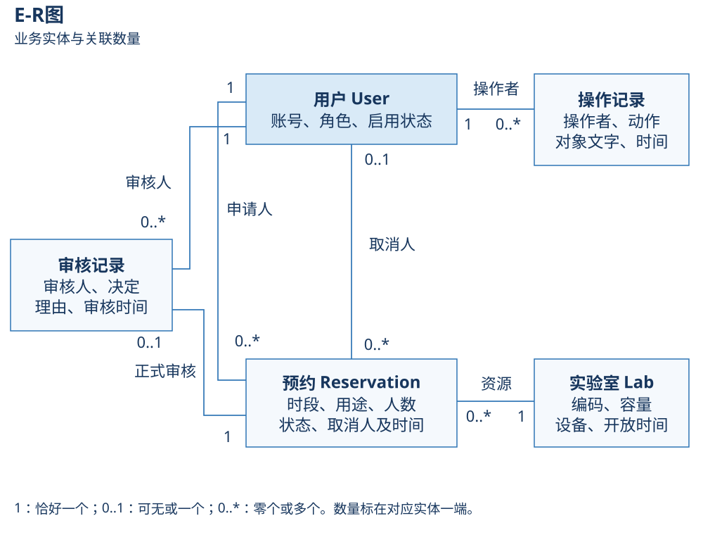

**数据库设计与数据字典——从业务资料到字段约束**

**一．先理解为什么要分表**

假设张同学连续申请三次实验室。若每条预约都复制一份他的账号、密码和角色，改密码时就要改三处，也容易不一致。把用户保存一次，预约只引用用户编号，就能找到同一个人。同理，实验室的容量和设备属于资源资料，预约只引用该实验室。

审核是“管理员何时作出什么决定”，与预约现在的状态不是同一事实。一条已批准预约后来被取消，过去的批准仍然发生过，因此审核单独保存。操作记录记录提交、维护、取消等关键动作，便于追溯。

**二．先掌握五个数据术语**

| 术语 | 通俗解释和例子 | 专业含义 |
|---|---|---|
| 表、记录、字段 | 表像台账；一行是一条预约；“人数”是一列 | 表组织同类记录，字段规定数据项 |
| 主键PK | 内部唯一编号，例如预约id=5 | 唯一识别一条记录，业务表使用自增主键 |
| 外键FK | 预约中保存用户编号，以便找到用户 | 字段引用另一表记录，数据库约束保护关联 |
| 唯一约束UK | 实验室编码不能出现两条相同资料 | UNIQUE拒绝重复值，别与“所有字段都不同”混淆 |
| 可空NULL | 尚未取消，没有取消时间 | NULL表示缺值；它不是时间0或文字“空” |

空字符串和NULL不同。设备说明可以为空字符串，表示没有填写文字；取消时间允许NULL，表示该业务事件尚未发生。密码存散列，是单向验证值，系统不提供把散列恢复为原密码的功能。

**三．关系数量用一句话读出来**

| 从一个对象出发 | 可以关联多少个另一对象 | 原因 |
|---|---|---|
| 一条预约 → 申请人 | 恰好1个用户 | 申请不能没有归属 |
| 一个用户 → 提交的预约 | 0到多条 | 可能尚未申请，也可以多次申请 |
| 一条预约 → 实验室 | 恰好1间 | 本项目预约整间资源，不做多资源组合 |
| 一间实验室 → 预约 | 0到多条 | 不同日期和相邻时段可有很多记录 |
| 一条预约 → 正式审核 | 0或1条 | 尚未审核时没有，正式审核只做一次 |
| 一条审核 → 预约/审核人 | 各1个 | 明确审核对象和责任人 |
| 一条预约 → 取消人 | 0或1个用户 | 未取消时为空，取消后明确操作者 |
| 一个用户 → 审核/取消/操作 | 各0到多条 | 可以执行多次相应行为 |

PROTECT是关联删除保护：不能直接删除仍被历史引用的用户、实验室等对象。业务采用停用，而不是破坏历史。AuditEvent.subject保存对象文字标识，没有预约外键；E-R图不能虚构这种数据库关联。

**四．业务数据字典**

下表中的“类型”是Django模型定义和逻辑约束。SQLite具体存储类型见schema.sql；不能仅凭varchar500字样认为所有长度在SQLite引擎层都自动强制执行。输入长度由表单和服务/模型校验保障。

| 业务对象 / 实际表 | 字段 | 类型、空值与约束 | 通俗含义 / 来源 |
|---|---|---|---|
| 用户 auth_user | id、username | 框架主键；用户名最长150且唯一 | 内部身份与登录账号 |
| 用户 | password | 框架散列字符串，不回填页面 | 从管理员设置的新密码生成 |
| 用户 | first_name、is_staff、is_active | 显示名最长150；两个布尔标志 | 名称、管理员角色、账号启用 |
| 实验室 labapp_lab | id、code | 自增主键；code最长32且唯一 | 内部编号与AUTO-301等业务编码 |
| 实验室 | name、location | 最长100/150，必填 | 名称、楼栋和房间，由管理员填写 |
| 实验室 | capacity | 正整数；CHECK要求>=1 | 一次预约最多可参加的人数 |
| 实验室 | equipment、description | 文本，可为空字符串 | 设备与使用说明 |
| 实验室 | open_time、close_time | 同日时间；close>open；服务限定分钟精度 | 每日开放边界，默认08:00—22:00 |
| 实验室 | is_active、updated_at | 布尔、最后更新时间 | 是否接受新预约、实际维护时刻 |
| 预约 labapp_reservation | id、applicant_id、lab_id | 自增主键；非空外键 | 谁申请了哪间资源；申请人取登录身份 |
| 预约 | start_at、end_at | 带时区时间；CHECK要求end>start | 用户填写的计划起止时刻 |
| 预约 | purpose、attendees | 用途最长500；正整数且>=1 | 使用目的、人数；服务再检查资源容量 |
| 预约 | request_key | UUID，唯一 | 同一次提交的识别标识，不是预约编号 |
| 预约 | status | 最长12，限定四个合法值 | 由服务设置当前业务状态 |
| 预约 | created_at | 自动记录创建时刻 | 何时提交，不用作预约日期统计口径 |
| 预约 | cancelled_at、cancelled_by_id | 可空时间、可空受保护外键 | 服务在真正取消时填写 |
| 审核 labapp_reviewrecord | id、reservation_id | 自增主键；预约外键唯一且非空 | 每条预约最多一次正式审核 |
| 审核 | reviewer_id、approved、reason | 非空外键、布尔、最长500文字 | 谁批准或拒绝；拒绝时理由必填 |
| 审核 | reviewed_at | 自动记录创建时刻 | 实际审核时刻 |
| 操作 labapp_auditevent | id、actor_id | 自增主键、非空外键 | 操作证据与操作者 |
| 操作 | action、subject | 最长32/120 | 稳定动作代码、被操作对象文字标识 |
| 操作 | detail、created_at | 说明文本、自动记录时刻 | 关键输入和变化，密码不进入说明 |

四个业务表各有隐式自增id，由DEFAULT_AUTO_FIELD=BigAutoField指定。框架另保存会话、权限组和迁移记录；auth_user不是本项目重新实现的登录表。

**五．数据流里的字段集合**

数据流图里“申请数据”是一个有具体内容的集合，不是空泛箭头。它在图上概括表示，在这里展开。

| 数据集合 | 具体内容 | 来源与去向 |
|---|---|---|
| 查询条件 | 关键词、最低容量、启停；占用日期；记录的实验室/状态/日期等 | 浏览器 → 表单 → 查询 |
| 预约申请 | lab_id、start_at、end_at、purpose、attendees、request_key | 资源地址和申请表 → 提交服务 |
| 当前身份 | 登录用户id及数据库复查的is_active/is_staff | 会话与用户资料 → 各业务入口 |
| 审核决定 | booking_id、approve/reject、reason | 管理员表单 → 审核服务 |
| 取消请求 | booking_id、confirm_cancel=yes、请求令牌 | 详情确认框 → 取消入口 |
| 维护资料 | 字典中允许维护的资源/账号字段 | 管理员表单 → 对应维护服务 |
| 统计结果 | 总数、四状态数量/比例、各资源申请数、获批计划小时 | 预约数据 → 只读统计 → 页面 |
| 操作记录结果 | 操作者、动作中文名、对象标识、说明、时间 | 管理员查询 → 操作记录页面 |

**六．约束与索引为什么这样选**

数据库CHECK像台账入口的基本检查：人数不能小于1，结束不能早于开始，状态只能是四值。跨两条预约的时间交叠不是一条记录自身的属性，必须由同一业务事务检查。不要把“数据库有约束”理解为可以绕过服务直接写任意SQL。

索引像书后的检索目录。booking_occupancy_idx按实验室、状态、开始时间组织，帮助找到可能占用的候选；booking_owner_date_idx帮助本人按日期查预约。end_at仍要参与实际交叠条件，索引不是预先证明“无冲突”的结果表。

这类分表减少了重复的身份、资源资料，符合规范化设计的基本目的。这里没有把当前资源名称当成历史时点快照；查询显示关联对象当前名称，而审核决定和实际操作时刻单独保留。

**七．重建、样本、运行库与备份**

migrate按迁移文件建立和升级表，并登记执行版本。schema.sql是已迁移演示库的空结构参考，不含数据及迁移版本行；日常优先migrate，不混用手工建表与迁移。

database/demo.sqlite3是初始3账号、4实验室、4种预约状态的交付快照；runtime/db.sqlite3是当前设备实际数据。seed_demo只补齐缺失项，不重置旧密码或旧预约。测试用独立库，源码包不含当前运行库。

备份用SQLite.backup取得一致快照。恢复前停止服务、保存当前数据、验证候选完整性，然后再替换目标；具体步骤见[运行维护说明](../04_运行与交付/运行维护说明.md)。
