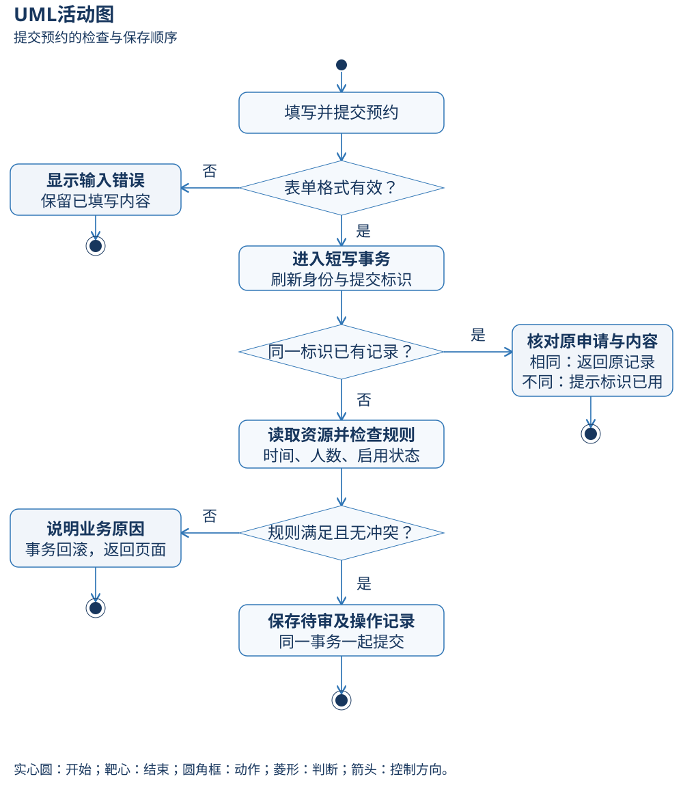
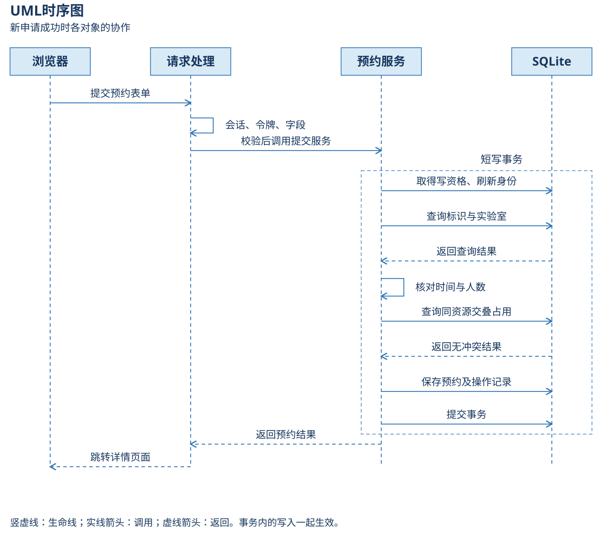

**详细设计与接口协议——把“怎样做”落实为可执行规则**

**一．先理解接口是什么**

接口是两个部分合作时的约定：交给谁、交什么、成功给回什么、失败怎样说明。例如视图交给预约服务“当前用户、实验室、时段、人数、用途”，服务给回预约对象和是否新建。双方按这套约定工作，不需要互相复制内部实现。

本项目有两类接口：浏览器通过地址和表单向Django发送请求；Python内部的视图通过函数参数调用服务。前者返回页面或跳转，后者返回对象/字典或业务异常。当前没有面向外部的公开JSON API。

**二．先解释请求相关术语**

| 名词 | 通俗意思 | 在本项目中怎么用 |
|---|---|---|
| URL / 路由 | 网页地址及其对应处理入口 | /labs/进入资源列表；config/urls.py登记映射 |
| GET | 读取资料 | 打开列表、详情、统计；不用于审核或取消 |
| POST | 提交会改变资料的操作 | 申请、审核、取消、维护、退出 |
| 表单绑定 | 把收到的字段放入表单检查 | 空POST也算提交，显示缺失必填项 |
| 会话Cookie | 浏览器携带的登录识别标识 | 框架在服务器据此认识当前用户 |
| CSRF令牌 | 用来检查写请求来源的校验值 | 表单提交csrfmiddlewaretoken；它不能证明管理权限 |
| UUID / request_key | 给同一次申请一张难重复的“收据号” | 重试原申请时认出已处理，不再新增；不是权限凭证 |
| DomainError | 正常业务拒绝的统一表达 | CONFLICT加中文原因，提示选择别的时段 |
| 事务、提交、回滚 | 一组保存一起生效，或一起撤销 | 预约与操作证据不能只留下其中一项 |
| 幂等 | 同一份请求重试，不产生第二份业务结果 | 同key、同人、同内容返回原预约 |
| HTTP状态码 | 请求处理类别的数字标记 | 200页面、302跳转、403禁止、404找不到、405方法不允许、500异常 |

页面返回200只能说明页面显示了；它也可能显示“时间冲突”。必须看业务消息与实际状态，不能把200直接当作预约成功。

**三．浏览器协议与权限**

表单使用URL编码字段，返回HTML或跳转；认证依靠会话。地址中的编号只用于定位对象，不赋予权限。以下路径与config/urls.py一致，id在实际地址中替换为相应数字。

| 地址 | 请求方法 | 角色 / 数据范围 | 输入与行为 |
|---|---|---|---|
| /login/ | GET、POST | 未登录或已有账号 | username、password；认证并建立会话 |
| /logout/ | POST | 当前会话 | 令牌；退出后到登录页 |
| /labs/ | GET | 登录用户 | q、min_capacity、active；资源列表 |
| /labs/{lab_id}/ | GET | 登录用户 | date；资源详情和占用时段，隐藏他人用途和身份 |
| /labs/{lab_id}/book/ | GET、POST | 申请人 | start_at、end_at、purpose、attendees、request_key |
| /bookings/ | GET | 本人或管理员全量 | lab、status、start_date、end_date、applicant、page |
| /bookings/{booking_id}/ | GET | 本人或管理员 | 申请、状态、审核、取消证据 |
| /bookings/{booking_id}/review/ | POST | 管理员 | decision=approve/reject、reason；更新待审预约 |
| /bookings/{booking_id}/cancel/ | POST | 本人或管理员 | confirm_cancel=yes、令牌；开始前取消 |
| /manage/labs/ | GET | 管理员 | 包括停用资源的维护列表 |
| /manage/labs/new/、/manage/labs/{lab_id}/ | GET、POST | 管理员 | 资源允许字段，新增或修改 |
| /manage/accounts/ | GET | 管理员 | 账号列表，不展示密码散列 |
| /manage/accounts/new/、/manage/accounts/{account_id}/ | GET、POST | 管理员 | username、first_name、password、is_staff、is_active |
| /statistics/ | GET | 本人或管理员全量 | start_date、end_date；当前状态汇总 |
| /manage/audit/ | GET | 管理员 | page；关键操作记录 |

applicant筛选只在管理员范围内生效，不能改变普通申请人的归属限制。写操作均接受框架CSRF检查；申请/维护表单中可填写什么由表单白名单决定。

未登录先跳转登录；管理角色不足返回403；不存在或他人详情返回404；专用写入口使用GET返回405；缺失CSRF返回403。业务拒绝回显表单或跳转详情显示消息，未预期异常返回友好500。

**四．内部服务契约**

actor是当前操作者的用户对象，pk/id是数据库内部编号。时间参数必须是带时区的datetime对象，人数是整数。视图已做格式检查，服务仍复查业务；直接从测试或演示命令调用服务也遵守同一规则。

| 服务 | 输入 | 成功返回 | 失败条件 / 责任 |
|---|---|---|---|
| submit_reservation | actor、lab_id、start_at、end_at、purpose、attendees、request_key；now仅供确定性测试 | (预约, created布尔) | 角色、资源、区间、容量、交叠、标识重复内容不一致 |
| review_reservation | actor、booking_id、approved布尔、reason；可选now | 更新后的预约 | 非管理员、非待审、过期批准、资源不兼容、冲突、拒绝无理由 |
| cancel_reservation | actor、booking_id；可选now | 已取消预约 | 非本人/管理员、已开始、已拒绝或已取消 |
| save_lab | actor、lab_id或None、values字段字典 | 保存后的实验室 | 非管理员、字段/编码非法、分钟精度、不兼容已有占用 |
| save_account | actor、account_id或None、values字典 | 保存后的用户 | 非管理员、重复/非法用户名、弱密码、新账号无密码、自身停用/降级 |
| summarize | actor、start_date、end_date | total、approved_hours、states、by_lab等字典 | 身份无效、日期倒置；只读 |

confirm_cancel=yes是浏览器取消入口的确认字段，内部取消服务不接收这个字段。确认体现用户意图；身份、归属、状态和时间仍由服务判断。

业务异常携带code和中文message，供测试与页面分别使用。例如INVALID_TIME表示时间规则不满足，CONFLICT表示存在占用，DATABASE_BUSY表示等待写资格失败。对象缺失由受限视图给404或服务给NOT_FOUND；其他程序异常保留原始诊断，不能伪装为成功。

**五．提交算法：为什么既要校验，又要事务**

具体输入例子：张同学选AUTO-301，填明天11:00—12:00、6人、PLC控制实验。当前资源容量24，开放08:00—22:00，已启用。程序按下面顺序处理。

1. 服务解析request_key为UUID，去掉用途两端空白，检查用途非空且不超过500字。
2. 进入IMMEDIATE短写事务，复查操作者启用/角色。管理员角色不执行申请。
3. 查同key；同申请人、实验室、时段、用途、人数完全相同，返回既有预约及False；不一致则拒绝，不泄露原记录。
4. 新请求才读取当前实验室，检查未来、开始早于结束、同日、分钟精度、开放范围、整数人数和启用。
5. 查同实验室PENDING/APPROVED的交叠记录。有一条交叠就拒绝。
6. 无交叠则保存PENDING，记录SUBMIT动作；事务退出成功才返回预约及True。

重复提交不是第二次申请。原预约已经取消时，再用旧标识重试只返回已取消的旧记录；若要新申请，应重新打开表单取得新标识，再接受正常冲突检查。

**六．冲突条件：用时间例子看懂不等号**

已有预约A为09:00—10:00。B若为09:30—10:30，两个区间有共同时间，冲突。B若为10:00—11:00，没有共同的使用时段，允许衔接。

专业表达采用半开区间[开始,结束)：包含开始，不包含结束。冲突条件为“原开始 < 新结束”并且“原结束 > 新开始”，还必须同一实验室且原记录为待审或已批准。批准时排除本预约，避免把自己当成冲突。

| B新区间 | 结果 | 理由 |
|---|---|---|
| 08:30—09:30 | 冲突 | 与A左半段相交 |
| 09:30—10:30 | 冲突 | 与A右半段相交 |
| 09:15—09:45 | 冲突 | 被A包含 |
| 08:30—10:30 | 冲突 | 包含A |
| 08:00—09:00或10:00—11:00 | 允许 | 只相邻，无正长度交叠 |
| 另一实验室09:00—10:00 | 允许 | 不占用同一资源 |

**七．两人同时申请时怎样保证不撞车**

若甲乙都先看到了“空闲”，再各自保存，单纯先查再写会产生两条重叠。方案是在查占用前先取得写事务资格。甲完成检查与保存后提交；乙再读取时看到甲的待审占用，就被拒绝。

SQLite本项目配置transaction_mode=IMMEDIATE、timeout=8。它不是每间实验室分别加一把锁，而是文件数据库的写者串行机制。因此事务只包住短期数据库处理，不包住用户填表；它适合本机课程场景，双连接测试也不证明大规模吞吐能力。

transaction.atomic负责整体生效：主数据、审核/取消证据和AuditEvent处于同一事务，任一步失败整体回滚。write_transaction只把locked/busy转换为DATABASE_BUSY，其他异常原样传播。

**八．审核、取消和维护的细节**

批准与拒绝都必须由管理员处理当前待审记录。批准再次核对时间、资源、容量及排除自身后的冲突；拒绝必须填写理由，但过期待审仍能被拒绝。状态、唯一ReviewRecord和对应AuditEvent一起保存。

取消在视图确认后进入服务，事务内复查身份、归属、当前状态和开始时刻。只允许待审/已批准且严格早于开始；更新状态、取消人和时刻，保存CANCEL操作。批准后取消仍保留原ReviewRecord。

实验室维护检查未结束的待审/已批准记录；停用、缩容量、收紧开放时间不能使这些占用失效。修改兼容的位置、设备或说明可以成功。所有开放时间也采用分钟精度。

账号维护只能写username、first_name、is_staff、is_active及通过验证的密码。新建必须设置密码；修改时空密码保留原值；本人不能停用或降级自己。实际改本人密码成功后，视图更新当前会话验证值。

**九．统计口径：数字代表什么**

日期两端包含，按预约开始日期选记录，再按当前状态计数。申请人只统计本人，管理员看系统。总数含四状态；approved_hours只累计当前APPROVED的计划区间小时，不是实际使用小时或实验室利用率。

例子：某日有1笔获批1小时和1笔待审2小时，总数2，获批计划时长1小时；获批记录后来取消，当前获批时长变为0。统计没有签到数据，不能据此判断是否实际使用过。

结束日通常用次日00:00作为排除上界；9999-12-31不能再加一天，服务使用datetime.max处理。合法分钟预约不会碰到最后微秒。零记录显示零，日期倒置显示错误。

**十．页面反馈和启动协议**

JavaScript仅做即时检查与提交按钮反馈。页面回显时立刻检查时段；提交后临时禁用原本可用的按钮；浏览器返回缓存页时恢复这些临时按钮，不恢复因业务状态本来就禁用的按钮。最终规则仍在服务器。

成功写入后采用POST→跳转→GET，也叫PRG：刷新结果页面只读取，不重新发送申请；真正的重试一致性由request_key及服务事务保障。

启动器检查解释器与1至65535端口，再执行migrate和本机服务。check_local_port.py用标准库短暂绑定127.0.0.1，Windows使用SO_EXCLUSIVEADDRUSE检查占用；失败不继续迁移，提示关闭已有服务或更换LAB_BOOKING_PORT。探测立即释放句柄，框架仍处理实际启动期间错误。脚本不安装依赖、不清空当前数据。

三个CMD入口只使用ASCII控制文本并保存CRLF换行；UTF-8中文提示由Python输出，避免批处理解释器对中文源行产生解析歧义。端口检查通过后显示下一步与访问说明，migrate完成后才调用runserver；真实监听成功以Django的启动信息为准。TC-031检查实际入口的字符集、换行、CMD解析、退出状态和提示输出，副本中的管理操作用无副作用输出替代，真实启动另用隔离数据库与端口核对。
